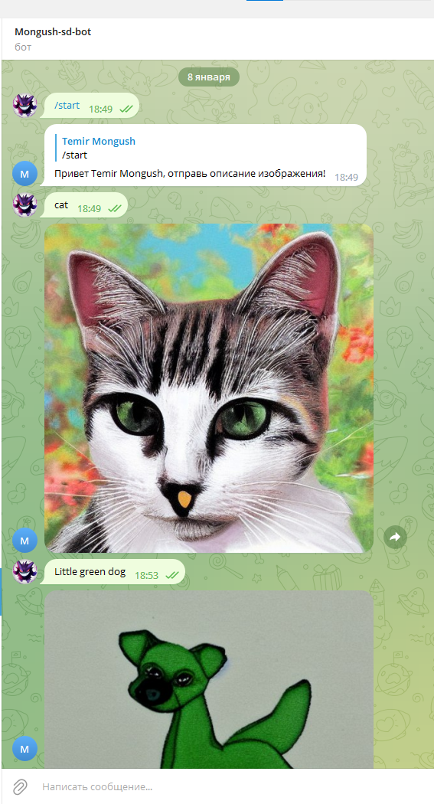
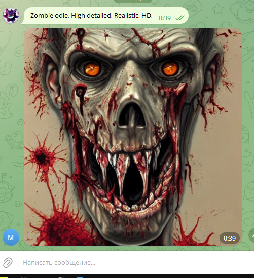
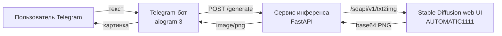

# text2image-bot

[](https://github.com/Mong1223/text2image-bot/actions/workflows/ci.yml)


Telegram-бот, который генерирует изображения по текстовому описанию с помощью
**Stable Diffusion**. Проект выполнен как курсовая работа по дисциплине «Нейронные сети»
(ТПУ, магистратура 09.04.01, 2023).

<p>
  
  
</p>

## Архитектура



- **Бот** (`src/text2image_bot/bot`) принимает описание, показывает статус «отправляет фото»
  и возвращает картинку.
- **Сервис инференса** (`src/text2image_bot/service`) — FastAPI-приложение с валидацией
  параметров. Модель подключается через сменный бэкенд:
  - `a1111` — [Stable Diffusion web UI](https://github.com/AUTOMATIC1111/stable-diffusion-webui) по HTTP API;
  - `dummy` — заглушка без нейросети для разработки и тестов без GPU.

Обзор моделей (DALL·E 2, Stable Diffusion, GLIDE, Craiyon, unCLIP, ERNIE-ViLG 2.0) —
в [docs/report.md](docs/report.md).

## Быстрый старт

### 1. Модель

Установите и запустите Stable Diffusion web UI с включённым API:

```bash
./webui.sh --api        # Linux / macOS
webui-user.bat --api    # Windows (или добавьте --api в COMMANDLINE_ARGS)
```

По умолчанию API доступно на `http://127.0.0.1:7860`. Без GPU этот шаг можно пропустить
и использовать `SERVICE_BACKEND=dummy`.

### 2. Установка

```bash
git clone https://github.com/Mong1223/text2image-bot.git
cd text2image-bot
python -m venv .venv
source .venv/bin/activate          # Windows: .venv\Scripts\activate
pip install -e .
```

### 3. Настройка

```bash
cp .env.example .env
```

Получите токен у [@BotFather](https://t.me/BotFather) и впишите его в `BOT_TOKEN`.

| Переменная | По умолчанию | Описание |
|---|---|---|
| `BOT_TOKEN` | — | токен Telegram-бота (обязательно) |
| `BOT_SERVICE_URL` | `http://127.0.0.1:8000` | адрес сервиса инференса |
| `SERVICE_BACKEND` | `a1111` | `a1111` или `dummy` |
| `SERVICE_A1111_URL` | `http://127.0.0.1:7860` | адрес Stable Diffusion web UI |
| `SERVICE_DEFAULT_STEPS` | `20` | число шагов диффузии |
| `SERVICE_DEFAULT_SAMPLER` | `Euler a` | сэмплер |

### 4. Запуск

В двух терминалах:

```bash
t2i-service        # или python -m text2image_bot.service
```

```bash
t2i-bot            # или python -m text2image_bot.bot
```

Откройте бота в Telegram, отправьте `/start`, затем описание, например
`Little green dog, high detailed, realistic`.

### Docker

```bash
docker compose up --build
```

Stable Diffusion web UI при этом работает на хосте; контейнер сервиса обращается к нему
через `host.docker.internal:7860`.

## API сервиса

Документация Swagger доступна по адресу `http://127.0.0.1:8000/docs`.

```bash
curl -X POST http://127.0.0.1:8000/generate \
  -H "Content-Type: application/json" \
  -d '{"prompt": "cat", "steps": 20, "width": 512, "height": 512}' \
  --output cat.png
```

| Поле | Тип | По умолчанию |
|---|---|---|
| `prompt` | str, 1–1000 символов | — |
| `negative_prompt` | str | `""` |
| `steps` | int, 1–150 | `SERVICE_DEFAULT_STEPS` |
| `width`, `height` | int, 64–1024, кратно 8 | `512` |
| `cfg_scale` | float, 1–30 | `7.0` |
| `seed` | int | `-1` (случайный) |

Ответ — `image/png`; при недоступности модели — `502`.

## Разработка

```bash
pip install -e ".[dev]"
ruff check .
pytest
```

## Структура проекта

```
text2image-bot/
├── src/text2image_bot/
│   ├── config.py            # настройки из .env
│   ├── bot/                 # Telegram-бот (aiogram 3)
│   └── service/             # сервис инференса (FastAPI) и бэкенды моделей
├── tests/                   # тесты сервиса и бэкендов
├── docs/                    # краткое содержание курсовой, скриншоты
├── Dockerfile, docker-compose.yml
└── pyproject.toml
```

## Лицензия

[MIT](LICENSE)
